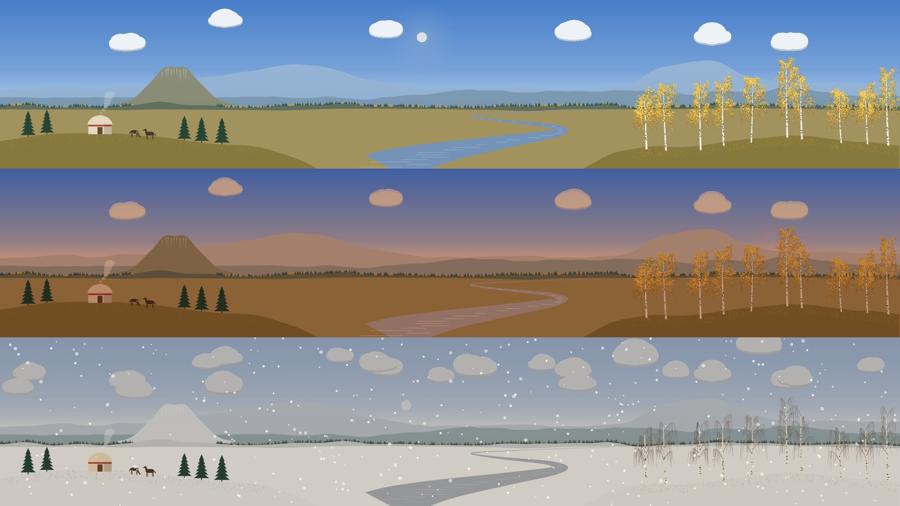

# Bashkortostan wallpaper

A drawn landscape of Bashkortostan that follows the real sky over your point:
the Southern Ural ridges with Yamantau and Iremel, a shikhan in the spirit of
Toratau, a yurt with horses, the Belaya river and a grove of weeping birches.



- **Three screens: one panorama.** With three monitors side by side each shows
  its own part of a 5760×1080 scene. With one or two monitors every screen gets
  a separate composition that fits all the motifs into one screen.
- **Sun and moon** are placed from the real sun position over the configured
  point (default: Ufa) and the current moon phase. The sky, the light and the
  haze over the far ridges follow the sun: dawn, day, golden hour, dusk,
  night with stars. After sunset a lamp lights up in the yurt.
- **Season** by date and temperature: green summer, golden autumn with fallen
  leaves, winter snow and bare birches, light spring green.
- **Weather** from [MET Norway](https://api.met.no/) every 30 minutes: clouds in
  three steps of cloudiness, rain, snow, sleet, fog, lightning.
- **Light animation**: rain and snow fall, clouds drift. Clouds move once a
  second, rain at 30 fps, snow at 20 fps, and only while it actually rains or
  snows.
- **Clock** in the middle of the main screen, like the clock wallpaper.
- **Top bar**: the wallpaper writes the brightness of the sky under the bar
  (`SkyLuminance`) and `panel-adaptive-text` switches the bar text to match.

## Install

```bash
components/bashkortostan-wallpaper/install.sh
```

It installs the package, takes the point from the Plasma Glass weather widget if
it is set up, and switches every desktop to the wallpaper. The previous desktop
config is saved first; to go back:

```bash
components/bashkortostan-wallpaper/install.sh --restore
```

After upgrading the package run `systemctl --user restart plasma-plasmashell`:
plasmashell keeps already loaded scripts in memory.

## Cost

Measured on the HP EliteBook (Intel graphics, three 1920×1080 screens), share of
one CPU core for plasmashell / KWin:

| State | plasmashell | KWin |
|---|---|---|
| No animation | 4% | 1% |
| Clouds drifting | 4% | 2% |
| Heavy rain | 23% | 13% |
| Heavy snow | 18% | 13% |

Animation can be turned off in the wallpaper settings.

## Testing a state

The hidden `Override` setting replaces the real sky, for example
`elevation=-20;precip=snow;clouds=0.9;snow=1` (keys: `elevation`, `azimuth`,
`clouds`, `precip` = none/rain/snow/sleet, `intensity`, `fog`, `thunder`,
`season`, `snow`):

```bash
qdbus6 org.kde.plasmashell /PlasmaShell org.kde.PlasmaShell.evaluateScript "
desktops().forEach(function (d) {
    d.currentConfigGroup = ['Wallpaper', 'org.plasmaglass.bashkortostan', 'General'];
    d.writeConfig('Override', 'elevation=-3;clouds=0.4');
});"
```

An empty `Override` returns to the real sky.

## How it is made

`tools/gen_scene.py` generates the landscape as SVG paths into
`contents/ui/scene3.js` (panorama) and `scene1.js` (one screen); the layout of
the motifs for each composition is at the top of the script. `palette.js`
colours every layer from the sun elevation, the season and the weather;
`sky.js` holds the astronomy and the met.no mapping; `Scene.qml` draws it.
The static landscape is rendered into one texture that is redrawn only when the
colours change (once a minute at most).

`tools/preview.py` renders a contact sheet without Plasma:

```bash
QT_QPA_PLATFORM=offscreen python3 tools/preview.py out.png            # 8 states, panorama
QT_QPA_PLATFORM=offscreen python3 tools/preview.py out.png --single   # one-screen composition
QT_QPA_PLATFORM=offscreen python3 tools/preview.py out.png --set=dusk # from afternoon to night
QT_QPA_PLATFORM=offscreen python3 tools/preview.py out.png --slice=3840 --states=1  # one screen, full size
```

Pitfalls found on the way: Plasma's GPU curve renderer drops quadratic segments
in multi-part paths (use polygons), overlapping shapes need `WindingFill`, and
`MultiEffect` blur did not render here (clouds are flat, the sun glow is a
radial gradient).
